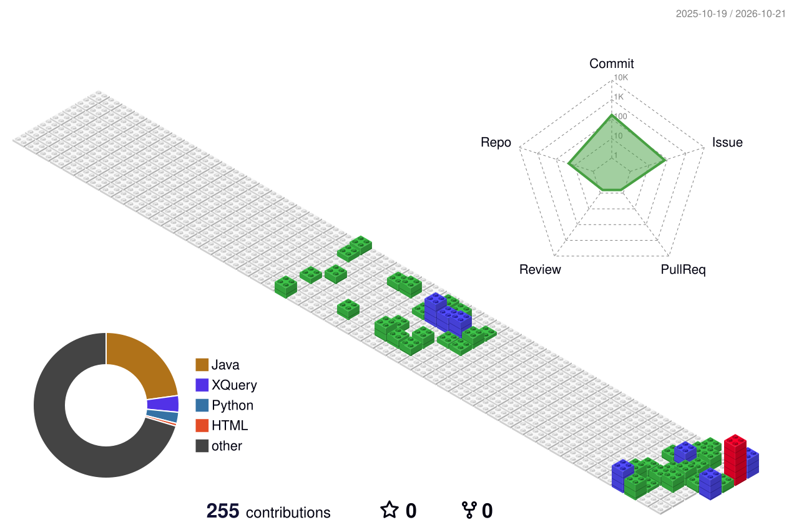

<h1 align="center">Hi 👋, I'm Santiago González</h1>
<h3 align="center">🎮 Aspiring Game Developer · 💻 2nd-year DAM Student · 🇪🇸 Seville, Spain</h3>

  
  
  

  

---

## 👨‍💻 About Me

I'm a second-year **Multiplatform Application Development (DAM)** student at EUSA, based in Seville, Spain. I'm interested in software development, gameplay programming, interactive experiences, and 3D creation. I like combining technical problem-solving with creative ideas and learning by building projects.

- 🎮 **Career goal:** become a Game Developer.
- 🕹️ **Exploring:** Unity, Unreal Engine, and Blender.
- 🧩 **I enjoy:** turning ideas into functional, interactive projects.
- 📚 **Next step:** continue studying game development after DAM.

## 🛠️ Technologies & Tools

### 💻 Software Development

  

### 🎮 Game Development & 3D

  

### ⚙️ Infrastructure & Other Tools

  

I also enjoy graphic design, experimenting with tools such as **GIMP**, and working on 3D modelling and 3D printing projects.

## 🚀 Featured Project

### 🌐 [AwacaTech](https://awacatech.es/)

A personal project focused on **video game news, analysis, guides, and comparisons**. It brings together my interest in gaming, digital content, and building things for the web.

## 🎓 Currently Learning

As part of my DAM studies, I'm developing my skills in:

- 💻 Application and software development
- 🗄️ Database design and SQL
- 🎨 User interface development
- 🐳 Development workflows and deployment
- 🎮 Game programming and interactive experiences

My current focus is strengthening my programming fundamentals while exploring the tools and workflows that could lead to a career in the video game industry.

## 🧱 My GitHub in 3D

  

A year of contributions, rebuilt as a little world of blocks. Generated and refreshed with GitHub Actions.

## 📊 GitHub Stats

  
  

  

## 🏆 GitHub Trophies

  

---

<i>🎮 Building today what I want to play tomorrow.</i>

